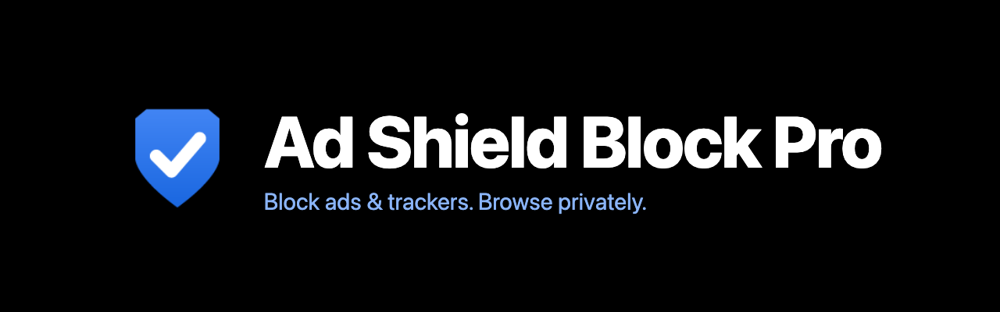
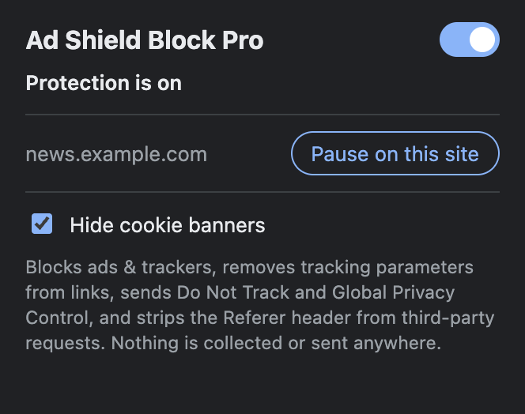
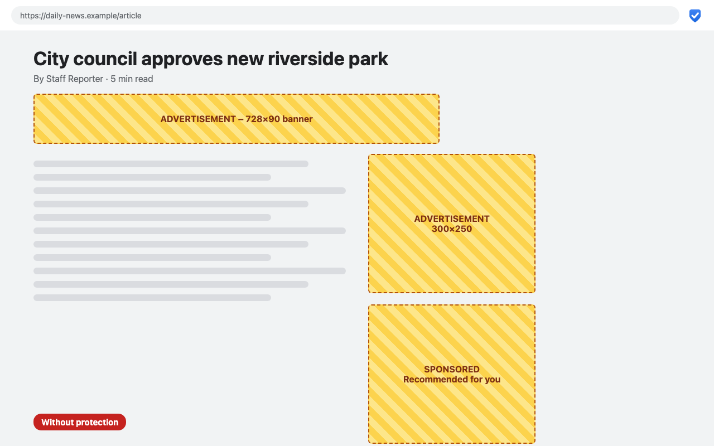
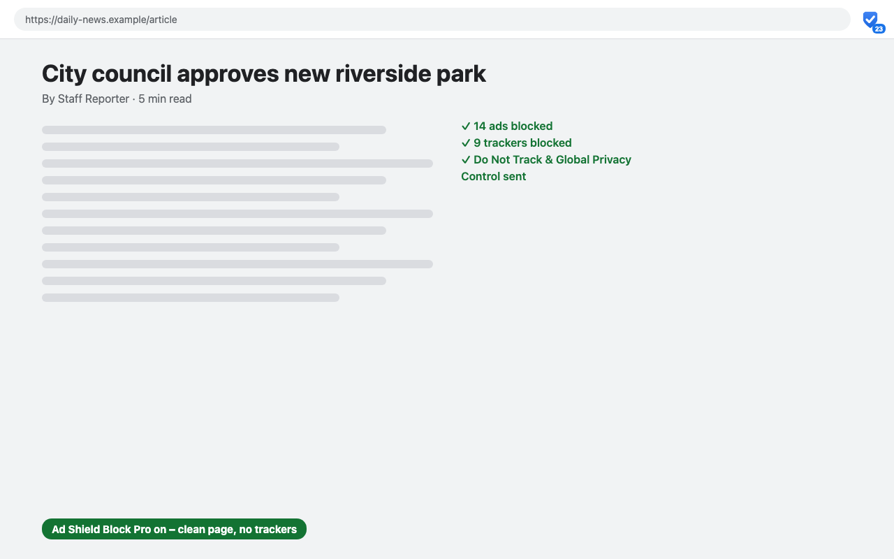

<p align="center">
  
</p>

<p align="center">
  <a href="https://github.com/mudasirahanger/ad-shield-block-pro/blob/main/LICENSE"></a>
  
  
  
  
  <a href="CONTRIBUTING.md"></a>
  <a href="https://github.com/mudasirahanger/ad-shield-block-pro/actions/workflows/ci.yml"></a>
  <a href="https://github.com/mudasirahanger/ad-shield-block-pro/stargazers"></a>
</p>

<p align="center">
  <a href="#install">Install</a> •
  <a href="#features">Features</a> •
  <a href="#screenshots">Screenshots</a> •
  <a href="#how-it-works">How it works</a> •
  <a href="CONTRIBUTING.md">Contributing</a> •
  <a href="#known-limitations">Known limitations</a>
</p>

<p align="center"><b>Fast, free and open-source ad &amp; tracker blocker for Chrome. No accounts. No analytics. Nothing leaves your browser.</b></p>

<p align="center">Install it in seconds, forget it's there, and browse cleaner, faster and more privately.</p>

## Features

| | |
|---|---|
| 🛑 **Ad blocking** | Blocks requests to 126 ad networks (Google Ads, Taboola, Criteo, Outbrain and more). |
| 🕵️ **Tracker blocking** | Blocks 138 analytics, session-replay and fingerprinting domains (Google Analytics, Hotjar, Facebook pixel, Clarity…). |
| 🔗 **Clean links** | Strips tracking parameters (`utm_*`, `fbclid`, `gclid`, `msclkid`, `mc_eid`…) from every page you open, so links can't tag you. |
| 🍪 **Cookie-banner hiding** | Hides common cookie-consent pop-ups (OneTrust, Cookiebot, Didomi, Quantcast…). Toggle in the popup. |
| 🛡️ **Privacy signals** | Sends *Do Not Track* and *Global Privacy Control* on every request. |
| 🙈 **Referer stripping** | Third-party requests no longer learn which page you came from. |
| 🧹 **Ad-slot cleanup** | Hides the empty boxes ads leave behind. |
| ⏸️ **Per-site pause** | One click to turn protection off for a site that breaks, one click to turn it back on. |
| 🔢 **Live counter** | The toolbar badge shows how many requests were blocked on the current tab. |
| 🌙 **Dark mode** | The popup follows your system theme. |
| 🔒 **Zero data collection** | No analytics, no accounts, no remote code, no network calls of its own. |
| 🧩 **Lightweight** | Uses Chrome's built-in blocking engine, so it adds no per-request JavaScript and barely touches performance. |

## Screenshots

<p align="center">
  
</p>

<p align="center">
  
  
</p>

<sub>The popup is a real capture from the running extension; the two page screenshots are illustrative mockups.</sub>

## Install

**From a release (recommended for now)**

1. Download `ad-shield-block-pro-<version>.zip` from the [Releases page](https://github.com/mudasirahanger/ad-shield-block-pro/releases) and unzip it.
2. Open `chrome://extensions` and enable **Developer mode**.
3. Click **Load unpacked** and select the unzipped folder.
4. Pin the shield icon to your toolbar.

**From source**

```bash
git clone https://github.com/mudasirahanger/ad-shield-block-pro.git
```

Then follow steps 2–4 above and select the cloned folder.

## Usage

- The shield icon badge shows blocked requests on the current tab.
- Click the icon to turn protection on/off everywhere, hide/show cookie banners, or **Pause on this site** if a page misbehaves.
- Found a site that breaks? [Open an issue](https://github.com/mudasirahanger/ad-shield-block-pro/issues/new/choose) with the URL.

## How it works

Blocking uses Chrome's `declarativeNetRequest` engine: rules are compiled by the browser itself, so the extension never reads your pages or traffic. Everything lives in this repo:

| Path | Purpose |
|------|---------|
| `manifest.json` | Extension manifest (Manifest V3) |
| `background.js` | Service worker: toggles rulesets, syncs the per-site allowlist, sets up the badge |
| `content.js` | Cosmetic filtering (ad slots, cookie banners); skipped on paused sites |
| `popup/` | Toolbar popup UI |
| `rules/` | Generated rulesets: `ads`, `trackers`, `patterns`, `params`, `privacy` |
| `tools/build-rules.js` | **Source of truth** for the block lists; regenerates `rules/*.json` |
| `tools/make-icons.py` | Regenerates the PNG icons |
| `store-assets/` | Screenshots, banner and promo images |

To add a domain: edit `tools/build-rules.js`, run `node tools/build-rules.js`, reload the extension.

## Contributing

Contributions of every size are welcome: new block-list entries, bug fixes, site-breakage reports, translations, docs. Read [CONTRIBUTING.md](CONTRIBUTING.md) to get started, and please follow the [Code of Conduct](CODE_OF_CONDUCT.md). Security issues: see [SECURITY.md](SECURITY.md).

## Roadmap

Ideas open for contributors:

- [ ] Import larger community filter lists (EasyList / EasyPrivacy) converted to Chrome rules
- [ ] Per-tab blocked-request breakdown in the popup
- [ ] Custom user rules and domain block/allow list
- [ ] Localisation (Hindi, Urdu, Arabic, Spanish…)
- [ ] Firefox port

## Known limitations

- Rules are domain/URL based. Ads served from a site's own domain (for example YouTube video ads) are not blocked.
- The block lists are curated by hand and much smaller than uBlock Origin's.
- Per-tab badge counts reset when the tab navigates.

## Privacy

Ad Shield Block Pro makes no network requests of its own and has no analytics. The only data it stores is your on/off setting, the cookie-banner option and the sites you paused, in `chrome.storage.local` on your device. See [CHROMEWEBSTORE.md](CHROMEWEBSTORE.md) for the full privacy policy text.

## Author

Created and maintained by **[Mudasir Ahanger](https://github.com/mudasirahanger)**.

## Contributors

<a href="https://github.com/mudasirahanger/ad-shield-block-pro/graphs/contributors">
  
</a>

## License

[MIT](LICENSE) © 2026 Mudasir Ahanger. Free to use, modify and share.
